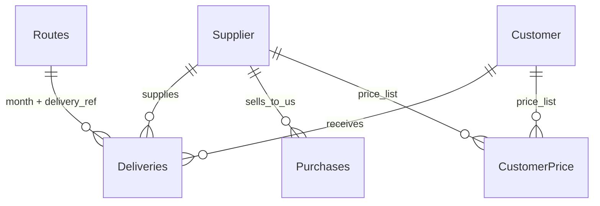

# Biomass Supply Chain Analysis

An end-to-end data analytics project built on **real operating data from my biomass trading business in Indonesia** (September to October 2026). The project covers 223 truck deliveries from 9 suppliers to 7 customers through 3 loading ports, together with pricing, route costs, gross profit and supplier purchase records.

All company, supplier and customer names are **anonymized**.

## Project status

- [x] Data collected from real operations and anonymized
- [x] Data cleaned, modelled into 5 related tables and validated (71 automated checks, 0 failures)
- [x] Tables exported to clean CSV files (UTF-8, comma-separated, ISO dates)
- [ ] SQL analysis (joins, aggregations, window functions)
- [ ] Python analysis (pandas, exploratory analysis)
- [ ] Power BI dashboard
- [ ] Findings and recommendations

## Business questions

1. Which suppliers, customers and ports carry the most volume, and which earn the most profit?
2. Is the highest-volume supplier also the most profitable per kg?
3. How concentrated is the business on a few customers or suppliers?
4. How did volume and gross profit change from September to October?
5. How do purchases from suppliers compare with what was actually delivered?
6. Which routes have the best and worst margin per kg, and why?

## Dataset

Five CSV files in [`data/`](data/). Prices and costs are in **Rupiah per kg**, quantities in **kg**, dates in `yyyy-mm-dd`.

| File | Rows | One row is... |
|---|---|---|
| `01_supplier.csv` | 10 | a supplier's buying price valid for a period |
| `02_customer.csv` | 24 | a customer's selling price for one supplier, with payment term |
| `03_deliveries.csv` | 223 | one truck delivery |
| `04_gross_profit.csv` | 31 | one route in one month, with cost, price, profit and quantity |
| `05_purchasing_history.csv` | 20 | one purchase from a supplier, with payment and delivery status |

### Relationships



`Supplier` is `01_supplier`, `Customer` and `CustomerPrice` come from `02_customer`, `Deliveries` is `03_deliveries`, `Routes` is `04_gross_profit` and `Purchases` is `05_purchasing_history`.

**Join keys for SQL**

| From | To | On |
|---|---|---|
| `03_deliveries` | `01_supplier` | `supplier_id` |
| `03_deliveries` | `02_customer` | `customer_id` and `supplier_id` |
| `03_deliveries` | `04_gross_profit` | `delivery_ref = delivery_code` and `month` |
| `05_purchasing_history` | `01_supplier` | `supplier_id` |

### Data dictionary

**`01_supplier.csv`**

| Column | Description |
|---|---|
| `no` | Row number |
| `supplier_id` | Supplier code (key) |
| `supplier_name` | Anonymized supplier name |
| `region`, `port_id` | Supplier's home region and usual port |
| `buying_price_per_kg` | Buying price per kg |
| `effective_from`, `effective_to` | Period the price is valid (empty = still valid) |

**`02_customer.csv`**

| Column | Description |
|---|---|
| `no` | Row number |
| `customer_id`, `customer_name` | Customer code and anonymized name |
| `supplier_id` | Supplier this selling price applies to |
| `selling_price_per_kg` | Selling price per kg |
| `effective_date` | Date the price starts |
| `payment_term` | Agreed payment terms |

**`03_deliveries.csv`**

| Column | Description |
|---|---|
| `no`, `delivery_id` | Fixed delivery number (1 to 223) and ID (`DEL-01` ...) |
| `date`, `month` | Delivery date and the first day of its month |
| `week` | Week 1 = days 1-7, Week 2 = 8-14, Week 3 = 15-21, Week 4 = day 22 to month end |
| `delivery_ref` | Route code (`supplier_id-customer_id`), links to `04_gross_profit` |
| `supplier_id`, `customer_id` | Who supplied and who received |
| `loading_port_id` | Port where the cargo was loaded |
| `qty_kg` | Quantity delivered (kg) |

**`04_gross_profit.csv`**

| Column | Description |
|---|---|
| `month`, `region`, `loading_port_id` | Month, supplier region and port of the route |
| `supplier_id`, `customer_id`, `delivery_code` | Route identifiers |
| `material_price_per_kg` | Buying price per kg for that month |
| `trucking_cost_per_kg`, `freight_per_kg` | Transport costs per kg |
| `total_cost_per_kg` | `material + trucking + freight` |
| `sales_price_per_kg` | Selling price per kg |
| `unit_profit_per_kg` | `sales_price_per_kg - total_cost_per_kg` |
| `qty_delivered_kg` | Sum of delivered kg for the route and month (from deliveries) |
| `total_gross_profit` | `unit_profit_per_kg x qty_delivered_kg` |

**`05_purchasing_history.csv`**

| Column | Description |
|---|---|
| `no` | Row number |
| `date`, `transaction_id` | Purchase date and number |
| `supplier_id` | Supplier |
| `unit_price_per_kg`, `qty_kg` | Purchase price and quantity |
| `total_amount`, `amount_paid` | Value of the purchase and amount paid |
| `delivered` | Kg already delivered against the purchase |
| `outstanding_deposit_kg`, `outstanding_amount` | Kg and value still owed by the supplier |

## Data at a glance

| Measure | Value |
|---|---|
| Period | 1 Sept to 31 Oct 2026 (45 delivery days) |
| Deliveries | 223 trucks (7,200 to 12,130 kg, average 9,579 kg) |
| Total quantity | 2,136,200 kg (Sept 1,206,130 kg, Oct 930,070 kg) |
| Suppliers / customers / ports | 9 / 7 / 3 (`BJM`, `BTL`, `SPT`) |
| Supplier-customer pairs | 24 |
| Gross profit | Rp 203,606,340 (about Rp 95 per kg) |
| Purchases | 20 transactions, 2,250,000 kg bought, 2,136,200 kg delivered, 113,800 kg outstanding |

## Data preparation and quality

The raw working files were cleaned and checked before any analysis:

- **Anonymization:** company, supplier and customer names were replaced, and the replacement was verified so that totals did not change.
- **Cleaning:** trailing spaces, inconsistent names, week and month labels, formula-based IDs, and mislabeled suppliers and ports were corrected and reconciled against purchase records.
- **Modelling:** one table per subject with unique keys, price history with effective dates, and no totals or blank rows inside the data.
- **Validation:** `audit_dataset.py` runs 74 checks on structure, formulas, keys, business rules, prices, totals and column names. Result: **71 pass, 0 fail, 3 warnings** (see notes below).
- **Reconciliation:** total quantity is identical across deliveries, routes and purchase records (2,136,200 kg), and the purchase "delivered" quantity matches the deliveries for every supplier.
- **CSV export:** every value and date in the CSV files was checked against the source workbook.

### Data notes

- Freight is 0 on one route (BGM to CAKRA) because the delivery ends at the loading port.
- Two deliveries on 20 Oct (STP to YAKIN, 8,930 kg each) have the same date, route and quantity and are kept as two separate records. [Confirm before publishing.]
- Routes with no deliveries in a month were removed, so every route row has real volume.
- Prices and costs are in Rupiah per kg. [State here whether they are real or scaled.]

## Repository structure

```
biomass-supply-chain-analysis/
├── README.md
├── audit_dataset.py        # data quality audit (74 checks, runs on the Excel workbook)
├── data/                   # the 5 CSV files
├── sql/                    # SQL queries
├── notebooks/              # Python analysis
└── dashboard/              # Power BI file and screenshots
```

## How to reproduce

1. Load the CSV files from `data/` into SQLite or PostgreSQL (one table per file).
2. Run the queries in `sql/`.
3. Open the notebooks in `notebooks/` for the Python analysis.

In Python:

```python
import pandas as pd
deliveries = pd.read_csv("data/03_deliveries.csv", parse_dates=["date", "month"])
```

## Tools

Excel (data preparation), SQL (SQLite or PostgreSQL), Python (pandas), Power BI.

## Key findings

*To be added after the SQL, Python and Power BI analysis.*

## Author

**AZHAR NASER**
Data analyst in training, working in biomass trading and supply chain company. This project uses data from my own operations to build and demonstrate skills in data cleaning, SQL, Python and business intelligence.

- LinkedIn: linkedin.com/in/azhar-naser-281b33217
- Email: azharnaser01@gmail.com
- GitHub: Azhar Naser

## Disclaimer

The data is anonymized and shared for educational and portfolio purposes only. Names, and where stated, values have been changed, so figures should not be used for commercial decisions.
